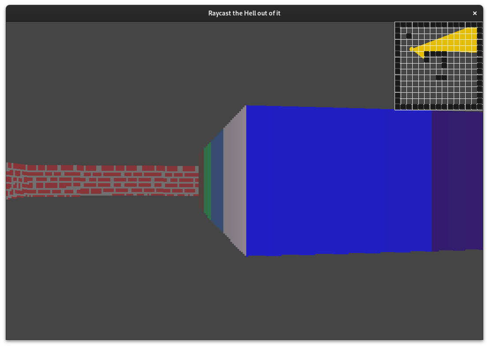

# Raycaster

A Wolfenstein-style **raycasting engine written from scratch in C** with [raylib](https://www.raylib.com/).
Raylib is used only to open a window and draw rectangles. The ray traversal, projection, texture mapping and collision code is all mine.



## Features
- **Grid ray traversal**: each ray jumps straight to the next vertical or horizontal grid line instead of advancing in small steps, so it costs a handful of operations per cell.
- **Fisheye correction**: wall height uses the perpendicular distance to the camera plane (dot product with the view direction), not the raw ray length.
- **Texture mapping**: the hit point on the wall picks the texture column, and screen height picks the texture row. Solid-color walls can have a different color per side.
- **Distance shading** for a sense of depth.
- **Collision detection** and **frame-rate–independent movement** (delta time).
- **Live minimap** that draws every cast ray.
- Redraws only when the player moves.

## Controls
| Key | Action |
|---|---|
| `W` / `S` | Move forward / backward |
| `A` / `D` | Strafe left / right |
| `←` / `→` | Rotate camera |

## Build & run
Requires a C compiler and raylib (`pacman -S raylib`, `apt install libraylib-dev`, or build from source).

```sh
make          # compile and run
make compile  # only compile -> bin/raycaster
```

## Project structure
```
src/main.c    # engine: map, ray stepping, rendering, input
src/types.h   # Cell / map types
resources/    # textures and screenshots
```

## What I learned
Floating-point edge cases when a ray lands exactly on a grid corner (epsilon handling), the trigonometry behind perspective projection, and keeping the render loop cheap.
